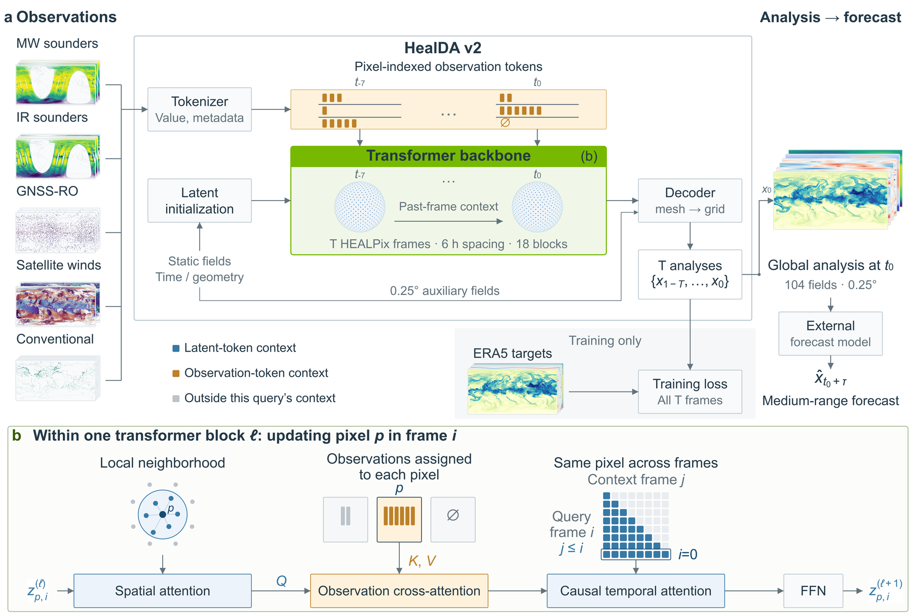

# HealDA


[](LICENSE)

[](https://nvlabs.github.io/HealDA/)

[](https://github.com/NVlabs/HealDA/actions/workflows/pre-commit.yml)
[](https://github.com/NVlabs/HealDA/actions/workflows/license-check.yml)
[](https://github.com/NVlabs/HealDA/actions/workflows/docs.yml)



HealDA is a package for observation-conditioned, HEALPix-grid
atmospheric data assimilation. It contains the full code for the model architecture,
distributed training, inference, and data loaders for observations and target
analysis states. The ETL code that produces the training observations (NNJA) and target
analyses (ERA5) is in `scripts/etl/` ([`docs/etl.md`](docs/etl.md)).

📖 [arXiv (v1)](https://arxiv.org/abs/2601.17636) 📦 [Checkpoints](https://huggingface.co/nvidia/healda-v2) 📚 [Documentation](https://nvlabs.github.io/HealDA/)

## Inference

The simplest way to run HealDA v2 is Earth2Studio's `HealDAv2`; see the
[HealDA v2 example](https://github.com/NVIDIA/earth2studio/blob/main/examples/05_data_assimilation/04_healda_v2.py).
It needs no data setup: each call downloads the NNJA BUFR files it needs and decodes them
on the fly with [earth2bufr](https://github.com/NVIDIA/earth2bufr). One global analysis
takes about 20 seconds on an H100, excluding download time, of which about 15 seconds is
CPU-side BUFR decoding and observation loading. It needs about 36 GB of GPU memory, within
a 40 GB card, and about 40 GB of host memory.

For repeated inference, build the NNJA archive and the ERA5 files once with the offline ETL
([`docs/etl.md`](docs/etl.md)) and run `healda-inference-local`, which reads the
observations and targets the checkpoint's recipe names over a date range and writes the
analyses to a Zarr store. This brings end-to-end inference under 1 second per analysis
on four GB300 GPUs (`--time-parallel 4`); see
[`examples/inference/local.sh`](examples/inference/local.sh). Training always needs the
[ETL'd data](#etld-data).

## Install

HealDA requires Python 3.11 or newer, PyTorch with CUDA support, and a compatible
GPU software stack.

```bash
uv sync
uv run healda-train --help
```

For an editable environment:

```bash
uv pip install -e .
healda-train --help
```

For training on Blackwell GPUs (compute capability 10.0 and newer), install the CuTe DSL
attention kernels. They are optional, but a significant speed-up (2-3x on the attention
kernels), and the 0.25 degree recipe requests them:

```bash
uv sync --extra cutedsl        # or: uv pip install -e '.[cutedsl]'
python -c "import cutlass.cute"
```

Without them, or on older GPUs, training falls back to slower Triton and einsum
implementations.

HealDA is licensed under the [Apache License 2.0](LICENSE).

## ETL'd data

Training and `healda-inference-local` read two datasets, ETL'd from their raw sources by
`scripts/etl/` ([`docs/etl.md`](docs/etl.md)):

- ERA5, the training targets, as 0.25 degree hourly HDF5 year files.
- NNJA, the observation inputs, as Parquet.

[`docs/observations.md`](docs/observations.md) describes the observation archive, what data
must satisfy to match a trained checkpoint, and the
[observation pipeline](docs/observations.md#observation-pipeline) from raw observations to
the model, including where your own observations can enter it.

## Training

`healda-train` is the packaged entry point. Training recipes are named presets:
one YAML file per preset in `src/healda/configs/loops/`. Each file names the preset
it `extends` and lists only the fields it changes, so the chain from the base recipe
to the v2 checkpoint (`v2-nnja-latlon-dense`) reads as a few differences per step;
`aliases` are other names a preset answers to. `--config` takes a preset name or the
path of a YAML file; `--name` names the run directory and defaults to the preset or
file name. A `--name` alone that is a preset still selects it; one that is not falls
back to the nested `--loop.*` options, which expose the underlying dataclasses (option
names retain underscores).

A new experiment is a file that extends a preset:

```yaml
extends: v2-nnja-latlon-dense
loop:
  lr: 1.0e-4
  obs_config:
    nnja_wind_dropout: 0.0
```

```bash
healda-train --config my-preset.yaml --verbose   # run directory my-preset
```

`--verbose` prints the resolved loop, every field, in the same YAML form. Write floats
with a decimal point and a signed exponent (`2.0e-4`, `1.0e+5`): YAML reads `2e-4` and
`1.0e5` as strings, and loading stops with an error that says so. Unknown field names
are errors too. The file is read on every launch, so editing it between segments of one
run changes that run.

Set paths through environment variables or a `.env` file:

```bash
export ERA5_HOURLY_ROOT=/data/era5_hourly/            # 0.25 degree ERA5 HDF5 year files
export ERA5_HOURLY_EXT_ROOT=/data/era5_hourly_ext/     # <variable>/<year>.h5
export NNJA_ROOT=/data/nnja/
export CHECKPOINT_ROOT=/runs

torchrun --standalone --nproc-per-node=1 \
  -m healda.cli.train --name debug-single-gpu --output_dir /runs
```

`debug-single-gpu` is a quick check: the v2 model at reduced depth and time length 1,
on one GPU. It needs the [ETL'd data](#etld-data). See
[`examples/training/minimal.sh`](examples/training/minimal.sh).

### Resume and fine-tune

Reusing the same `--output_dir` and `--name` automatically resumes the newest
valid `training-state-*.checkpoint` in that run directory. An alternate run can
be searched with `--resume_dir`:

```bash
healda-train --name debug-single-gpu --output_dir /runs \
  --resume_dir /runs/previous-run
```

`--finetune_from` initializes model weights from a checkpoint only when no
resumable checkpoint is found. Optimizer and iterator state are not restored by
the CLI fine-tuning path, and the sample count starts at zero, so the preset's
learning-rate schedule (warm-up and decay) runs from the start: give a fine-tuning
preset its own schedule. Resuming the original run instead continues it at the end of
its schedule. See
[`examples/fine_tuning/from_checkpoint.sh`](examples/fine_tuning/from_checkpoint.sh),
which fine-tunes the v2 checkpoint.

## Configuration structure

Configuration has three layers:

1. Environment variables locate state stores, ETL'd observations, output
   directories, and optional remote profiles.
2. `--name` selects a built-in `TrainingLoop` preset.
3. Top-level CLI fields (`--output_dir`, `--resume_dir`, `--finetune_from`) and
   nested `--loop.*` flags configure a run without a preset.

Run `healda-train --help` against the installed version for the authoritative
flag list. If `--name` does not match a preset, the CLI uses the `--loop.*`
configuration. If it does match, the preset is used as defined and `--loop.*` flags are
ignored: a run with different settings needs its own preset.

## Distributed execution

Launch with `torchrun`, or with a scheduler that supplies the standard rank
environment. HealDA supports data parallelism, optional FSDP over the data
dimension, and explicit time and space activation sharding. The world size must
be divisible by `time_parallel * space_parallel`; the video length must also be
compatible with time sharding. FSDP with `space_parallel > 1` is not wired.
Multi-process and multi-node configurations require CUDA/NCCL.

## Hardware

The v2 checkpoint was trained on 32 GB300 GPUs, with 8-way time parallelism and
4-way data parallelism, at about 90,000 samples per 4 hours with the CuTe DSL kernels
installed (see [Install](#install)).

Set `PYTORCH_CUDA_ALLOC_CONF=expandable_segments:True` for training and inference. The
observation count changes from batch to batch, which causes memory fragmentation in
PyTorch's caching allocator. With it enabled, training the v2 configuration needs about 150 GB of
GPU memory.

Activation checkpointing lowers this for GPUs with less memory. `gradient_checkpointing=2`
checkpoints whole transformer blocks and saves about 4 GB per block;
`gradient_checkpointing_last_n=N` applies it to the last `N` of the 18 blocks (0 for all).
Checkpointing the last 6 blocks takes training from about 150 GB to about 125 GB, within a
141 GB H200. Checkpointing all 18 takes it to about 70 GB, within an 80 GB H100.

## Contributing

This project is currently not accepting contributions.

See [`CONTRIBUTING.md`](CONTRIBUTING.md) for development guidance.

## Disclaimer

This project will download and install additional third-party open-source
software. Review the license terms of those projects before use.
