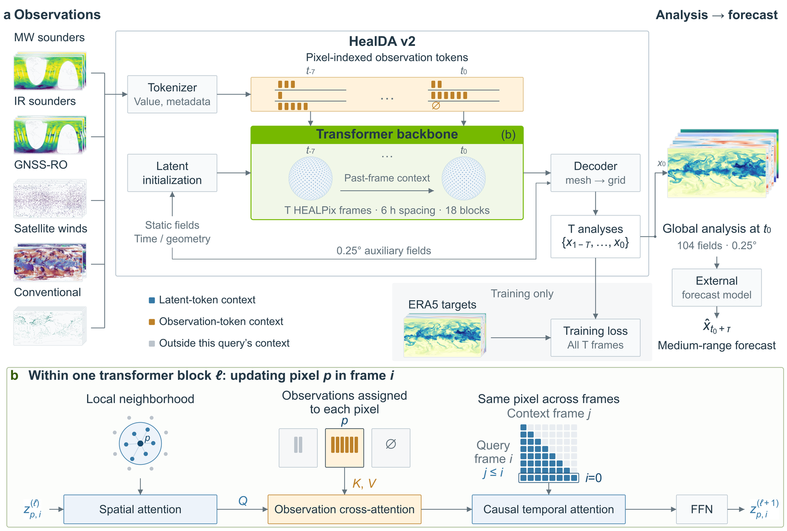

# HealDA


[](LICENSE)

[](https://nvlabs.github.io/HealDA/)

[](https://github.com/NVlabs/HealDA/actions/workflows/pre-commit.yml)
[](https://github.com/NVlabs/HealDA/actions/workflows/license-check.yml)
[](https://github.com/NVlabs/HealDA/actions/workflows/docs.yml)



HealDA is an experimental package for observation-conditioned, HEALPix-grid
atmospheric data assimilation. It contains the model architecture, distributed
training, inference, and data loaders for prepared observations (Parquet) and
target analysis states, with the observation filtering, thinning and
normalization applied on load. It does not include raw-data ETL.

📖 [arXiv (v1)](https://arxiv.org/abs/2601.17636) 📦 [Checkpoints](https://huggingface.co/nvidia/healda-v2) 📚 [Documentation](https://nvlabs.github.io/HealDA/)

## Inference

Earth2Studio runs the released checkpoint on NNJA observations as `HealDAv2`; see the
[HealDA v2 example](https://github.com/NVIDIA/earth2studio/blob/main/examples/05_data_assimilation/04_healda_v2.py).
Each call downloads the NNJA BUFR files it needs and decodes them on the fly with
[earth2bufr](https://github.com/NVIDIA/earth2bufr).

With observations already prepared in the NNJA archive layout
([`docs/observations.md`](docs/observations.md)), `healda-inference-local` runs the model
over a date range and writes the analyses to a Zarr store. The scripts that build this
archive, also based on earth2bufr, are not yet released.

The [observation pipeline](docs/observations.md#observation-pipeline) describes each stage
from raw observations to the model, and where your own observations can enter it.

## Install

HealDA requires Python 3.11 or newer, PyTorch with CUDA support, and a compatible
GPU software stack.

```bash
uv sync
uv run healda-train --help
```

For an editable environment:

```bash
uv pip install -e .
healda-train --help
```

For training on Blackwell GPUs (compute capability 10.0 and newer), install the CuTe DSL
attention kernels. They are optional, but a significant speed-up (2-3x on the attention
kernels), and the 0.25 degree recipe requests them:

```bash
uv sync --extra cutedsl        # or: uv pip install -e '.[cutedsl]'
python -c "import cutlass.cute"
```

Without them, or on older GPUs, training falls back to slower Triton and einsum
implementations.

HealDA is licensed under the [Apache License 2.0](LICENSE).

## Training

`healda-train` is the packaged entry point. Training recipes are named presets
in `healda.cli.train`; nested `--loop.*` options expose the underlying
dataclasses. Option names retain underscores.

Set paths through environment variables or a `.env` file:

```bash
export ERA5_HPX64_104CH_ZARR=/data/era5_hpx64_104ch.zarr
export NNJA_ROOT=/data/nnja/
export CHECKPOINT_ROOT=/runs

torchrun --standalone --nproc-per-node=1 \
  -m healda.cli.train --name debug-single-gpu --output_dir /runs
```

This smoke recipe is minimal in duration, not in data requirements. It expects
the prepared state Zarr and NNJA observation archive used by the selected
recipe. See [`examples/training/minimal.sh`](examples/training/minimal.sh).

### Resume and fine-tune

Reusing the same `--output_dir` and `--name` automatically resumes the newest
valid `training-state-*.checkpoint` in that run directory. An alternate run can
be searched with `--resume_dir`:

```bash
healda-train --name debug-single-gpu --output_dir /runs \
  --resume_dir /runs/previous-run
```

`--finetune_from` initializes model weights from a checkpoint only when no
resumable checkpoint is found. Optimizer and iterator state are not restored by
the CLI fine-tuning path, and the sample count starts at zero, so the preset's
learning-rate schedule (warm-up and decay) runs from the start: give a fine-tuning
preset its own schedule. Resuming the original run instead continues it at the end of
its schedule. See
[`examples/fine_tuning/from_checkpoint.sh`](examples/fine_tuning/from_checkpoint.sh),
which uses the HEALPix smoke recipe and does not load the 0.25 degree checkpoints.

## Configuration structure

Configuration has three layers:

1. Environment variables locate state stores, prepared observations, output
   directories, and optional remote profiles.
2. `--name` selects a built-in `TrainingLoop` preset.
3. Top-level CLI fields (`--output_dir`, `--resume_dir`, `--finetune_from`) and
   nested `--loop.*` flags configure a run without a preset.

Run `healda-train --help` against the installed version for the authoritative
flag list. If `--name` does not match a preset, the CLI uses the `--loop.*`
configuration. If it does match, the preset is used as defined and `--loop.*` flags are
ignored: a run with different settings needs its own preset.

## Distributed execution

Launch with `torchrun`, or with a scheduler that supplies the standard rank
environment. HealDA supports data parallelism, optional FSDP over the data
dimension, and explicit time and space activation sharding. The world size must
be divisible by `time_parallel * space_parallel`; the video length must also be
compatible with time sharding. FSDP with `space_parallel > 1` is not wired.
Multi-process and multi-node configurations require CUDA/NCCL.

## Hardware

The released checkpoint was trained on 32 GB300 GPUs, with 8-way time parallelism and
4-way data parallelism, at about 90,000 samples per 4 hours with the CuTe DSL kernels
installed (see [Install](#install)).

Set `PYTORCH_CUDA_ALLOC_CONF=expandable_segments:True` for training and inference. The
observation count changes from batch to batch, which causes memory fragmentation in
PyTorch's caching allocator. With it enabled, training the released recipe needs about 150 GB of
GPU memory.

Activation checkpointing lowers this for GPUs with less memory. `gradient_checkpointing=2`
checkpoints whole transformer blocks and saves about 4 GB per block;
`gradient_checkpointing_last_n=N` applies it to the last `N` of the 18 blocks (0 for all).
Checkpointing the last 6 blocks takes training from about 150 GB to about 125 GB, within a
141 GB H200. Checkpointing all 18 takes it to about 70 GB, within an 80 GB H100.

Each analysis of the released checkpoint reads about 200 million observation tokens.
Through Earth2Studio's `HealDAv2`, one analysis needs about 36 GB of GPU memory, within a
40 GB card, and about 40 GB of host memory, including decoding the observations.

## Prepared observation input

Training reads prepared Parquet observations from the NNJA archive (`NNJA_ROOT`),
the source the checkpoints are trained on. The older UFS replay archive
(`UFS_OBS_PATH`) is still readable for earlier runs. Each has its own layout, schema
and channel vocabulary, and a checkpoint reads only the source it was trained on.
See [`docs/observations.md`](docs/observations.md), including what data
must satisfy to match a trained checkpoint.

## Contributing

This project is currently not accepting contributions.

See [`CONTRIBUTING.md`](CONTRIBUTING.md) for development guidance.

## Disclaimer

This project will download and install additional third-party open-source
software. Review the license terms of those projects before use.
